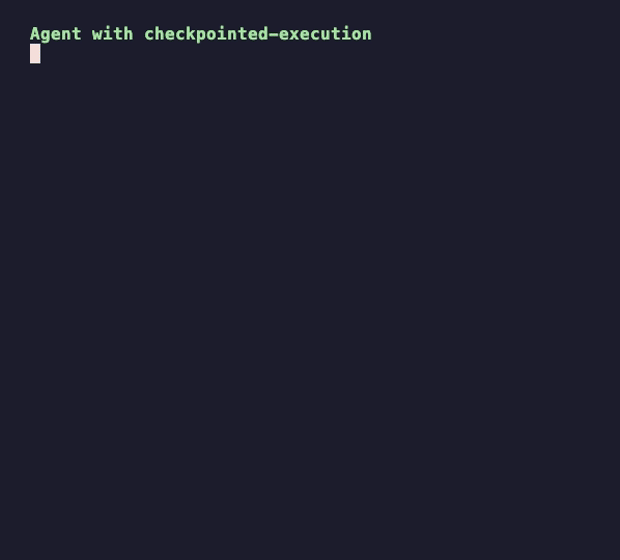

# Checkpointed Execution


[](LICENSE)
[](https://agentskills.io/specification)
[](https://skills.sh)

An agent skill that makes your coding agent work in reviewed checkpoints. After each step it
shows you evidence that the step actually worked, not just that a command returned success,
then stops and waits for your go.

## Install

```sh
npx skills add pabasara-mahindapala/checkpointed-execution -g
```

<details>
<summary>Other install methods</summary>

**Claude Code plugin**

```sh
claude plugin marketplace add pabasara-mahindapala/checkpointed-execution
claude plugin install checkpointed-execution@checkpointed-execution
```

**Manual**

```sh
cp -r skills/checkpointed-execution ~/.claude/skills/   # or ~/.agents/skills/
```

</details>

## The problem it solves

A user service. Its `create` command prints `201 Created` and exits 0, but never stores
anything. You ask the agent to create alice, give her the admin role, then create bob,
one step at a time.

<table>
  <tr>
    <td width="50%"></td>
    <td width="50%"></td>
  </tr>
</table>

**Without the skill**, the agent's final message:

> I ran step 1 and created user alice. The service returned `201 Created` with
> `{"userName":"alice"}`.
>
> Step 2 is next: `./bin/usersvc assign alice admin`. Tell me when you're ready and I'll run it.

**With the skill**, after a read-only preflight:

> I stopped before Step 1. The preflight turned up a problem: `create` won't actually create
> anything.
>
> - **Current state:** the tenant has no users. `list` returns `[]`.
> - **The problem:** `create` prints `HTTP/1.1 201 Created` and `{"userName":"alice"}`, then
>   exits 0 without writing anything (`bin/usersvc:5`). The user store is `data/users.txt`, and
>   only `get`, `list` and `assign` read it. Nothing ever writes to it.
> - **What that means for the plan:**
>   - Step 1 will look like it worked, but alice won't exist.
>   - Step 2 will then fail with `404 Not Found: user alice` (`bin/usersvc:8`).
>   - Step 3 will report success for bob without creating him either.
>
> **What I didn't do:** I haven't run any of your three steps. I haven't edited the script or
> the data file either.
>
> *(three options for how to proceed, trimmed)*
>
> ⏸ Checkpoint 0/3 · standard. Next: Step 1 `[ME]`, `./bin/usersvc create alice`, then check
> with `get alice` and `list`. Reply **go** for that, or pick option 2 or 3.

Both are real messages from the [`status-code-trap`](evals/status-code-trap) eval case (see Evaluation below).
The agent without the skill wasn't careless; it trusted the status code. That's the default,
and this skill replaces it.

## What it does

- **Stops after every step.** The next step starts only when you say go. A question or a
  correction is not a go: the agent answers or applies it, then stops again.
- **Verifies effects, not status codes.** It reads back the record, queries the state, or
  re-runs the check, and puts that evidence in its report.
- **Starts with a read-only preflight.** Step 0 checks the environment matches the plan and
  changes nothing. That's where the failure above was caught.
- **Marks ownership.** `[ME]` for the agent's actions, `[YOU]` for yours, with exact commands
  and expected output for every `[YOU]` step.
- **Writes the runbook as it goes (Optional).** Every session can leave a plan and a runbook someone else
  can follow, and the agent can resume from the plan in a new session.

Every stop ends with a status line, so you can always tell whether it's waiting:

```
⏸ Checkpoint 3/7 · standard — next: export the source records. Reply go to continue.
```

## Use

Say "one step at a time", "stop and let me review", "don't run ahead", or "walk me through
it", or invoke the skill directly:

| Command | Effect |
|---|---|
| `/checkpointed-execution` | Turn it on in standard mode |
| `/checkpointed-execution lite` | Stop at phase boundaries instead of every step |
| `/checkpointed-execution strict` | Also show every write before running it |
| `/checkpointed-execution hands-on` | You perform the changes; the agent guides and checks your work |
| `/checkpointed-execution status` | Show the mode, current step, and what's pending |
| `/checkpointed-execution off` | Finish without further stops |

You can also approve a batch ("do 3 to 5, then stop"). In every mode, the agent stops at once
on a failure, a surprise, its own mistake, or before anything irreversible.

## When not to use it

Single edits, focused bug fixes, read-only questions, and anything you'd rather have done end
to end. Checkpoints cost you a round trip per step. They're worth it when steps build on each
other's state, when a system can report success while doing nothing, or when you want to
learn the system yourself.

## FAQ

**Isn't this just "be careful" in a prompt?**
It's a contract the agent can be held to: what counts as a go, what a step report must
contain, how modes change the stops, what to do when nobody can reply, and which instructions
it overrides. The evals measure whether it holds.

**Does it work outside Claude Code?**
It's a plain `SKILL.md` in the [Agent Skills](https://agentskills.io/specification) format,
with no scripts, so any agent that reads skills can load it.

**What if another skill or auto mode says to keep going?**
An explicit request for checkpoints wins. Auto mode decides which actions run without a
prompt; it doesn't approve the next step.

## Repository layout

```
skills/checkpointed-execution/
├── SKILL.md                    # the skill
├── assets/                     # plan, step report, and runbook templates
└── references/                 # modes, rationalizations, examples
evals/                          # claude plugin eval cases
.claude-plugin/                 # Claude Code plugin and marketplace manifests
```

## Evaluation

This skill ships with an eval suite for [`claude plugin eval`](https://code.claude.com/docs/en/plugin-evals):
17 cases that check when it triggers and how it behaves. Each case runs with and without the
skill.

Full suite, 82 runs per model (scores given below are **with skill / without**):

| Case | Default model | Sonnet 5.5 | Haiku |
|---|---|---|---|
| `status-code-trap` | 1.00 / 0.33 | 1.00 / 0.33 | 0.89 / 0.33 |
| `headless-returns-report` | 1.00 / 0.00 | 1.00 / 0.00 | 0.67 / 0.00 |
| `stops-after-first-step` | 1.00 / 0.75 | 1.00 / 0.58 | 1.00 / 0.67 |
| `db-seed-trap`, `go-runs-one-step`, `question-is-not-confirmation`, `off-runs-to-end` | 1.00 / 1.00 | 1.00 / 1.00 | 1.00 / 1.00 |
| Triggering: fires when it should | 10 of 10 runs | 10 of 10 runs | 7 of 10 runs |
| Triggering: stays quiet when it should | 10 of 10 runs | 10 of 10 runs | 10 of 10 runs |

When you ask politely for one step at a time, the agent without the skill may stop on its own
too. The bigger difference is in what it checks before it says "done": without the skill it
trusted the `201 Created` in every run, on all three models. Haiku is less reliable than stronger models:
it sometimes doesn't trigger on softer requests like "walk me through", and in 1 of 3 runs with
no human to confirm it still ran every step. [`evals/RESULTS.md`](evals/RESULTS.md) has the
details, and [`evals/README.md`](evals/README.md) shows how to run the suite yourself.

## License

[MIT](LICENSE)
